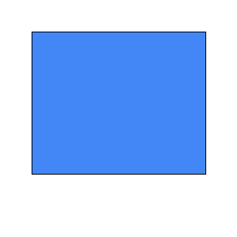
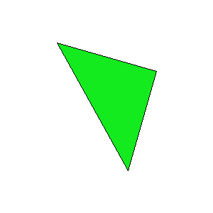
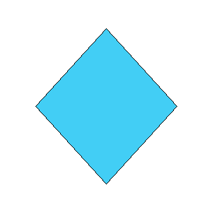
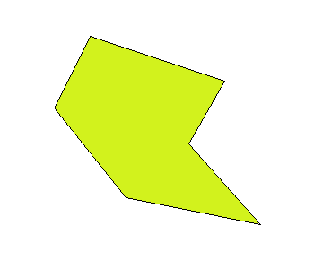
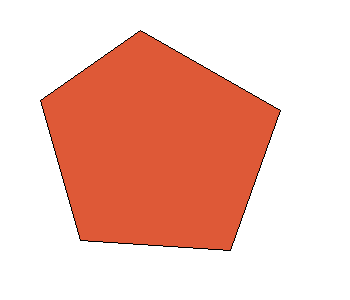

# Отрисовка многоугольника алгоритмом Брезенхема и последующее его заполнение методом волновой затравки

### Вход
---

На входе программы пользователя потребуют ввести следующее:

```Ширина и Высота``` - размер изображения в пикселях 
   
```Количество вершин``` - ожидаемое количество вершин многоугольника  
  
```Вершины``` - каждую вершину по отдельности через Enter  
  
```Вершину затравки``` - вершину лежащую в многоугольнике  
  
```Цвет заполнения``` - цвет заполнения многоугольника в формате R G B  

### Описание
---

Код обеспечивает закраску многоугольника, отрисованного на заданных вершинах, заданным цветом. Цвет обводки многоугольника является неизменяемым и является черным. Цвет заливки может выбрать сам пользователь.

Предполагается, что указанные вершины идут друг за другом, а ребра не пересекаются. Координаты вершин за рамки изображения не выходят.

Первоначально строятся отрезки между вершинами, применяя алгоритм Брезенхема. То есть, выбирается приращение дельта, основываясь на том, какая из координат растет быстрее, а какая медленнее, а далее, путем манипуляций с целочисленными координатами, выбирается какой пиксель будет закрашиваться следующим. 

После того, как многоугольник был отрисован, в ход идет алгоритм волновой затравки. Выбирается стартовая точка и сразу закрашивается. После этого строится четырехсвязный фронт волны. Соседи точки проверяются на цвет, закрашиваются и добавляются в массив. После цикла, текущий фронт волны забирает значения следующего, а следующий фронт волны, в свою очередь, получает новые пиксели.

### Примеры
---

#### Тест 1 - прямоугольник

```
Ширина Высота: 300 300
Количество вершин: 4
Вершина 1: 40 40
Вершина 2: 260 40
Вершина 3: 260 220
Вершина 4: 40 220
Затравочная вершина: 150 150
Цвет заливки: 66 135 245
```

<p align="center">
  
</p>

#### Тест 2 - треугольник

```
Ширина Высота: 300 300
Количество вершин: 3
Вершина 1: 80 60
Вершина 2: 220 100
Вершина 3: 180 240
Затравочная вершина: 83 64
Цвет заливки: 19 235 30
```

<p align="center">
  
</p>

#### Тест 3 - повернутый прямоугольник

```
Ширина Высота: 300 300
Количество вершин: 4
Вершина 1: 150 40
Вершина 2: 250 150
Вершина 3: 150 260
Вершина 4: 50 150
Затравочная вершина: 150 150
Цвет заливки: 66 206 245
```

<p align="center">
  
</p>

#### Тест 4 - шестиугольник

```
Ширина Высота: 350 300
Количество вершин: 6
Вершина 1: 100 40
Вершина 2: 250 90
Вершина 3: 210 160
Вершина 4: 290 250
Вершина 5: 140 220
Вершина 6: 60 120
Затравочная вершина: 170 140
Цвет заливки: 210 242 29
```

<p align="center">
  
</p>

#### Тест 5 - повернутый пятиугольник

```
Ширина Высота: 350 300
Количество вершин: 5
Вершина 1: 140 30
Вершина 2: 280 110
Вершина 3: 230 250
Вершина 4: 80 240
Вершина 5: 40 100
Затравочная вершина: 160 140
Цвет заливки: 222 89 55
```

<p align="center">
  
</p>
